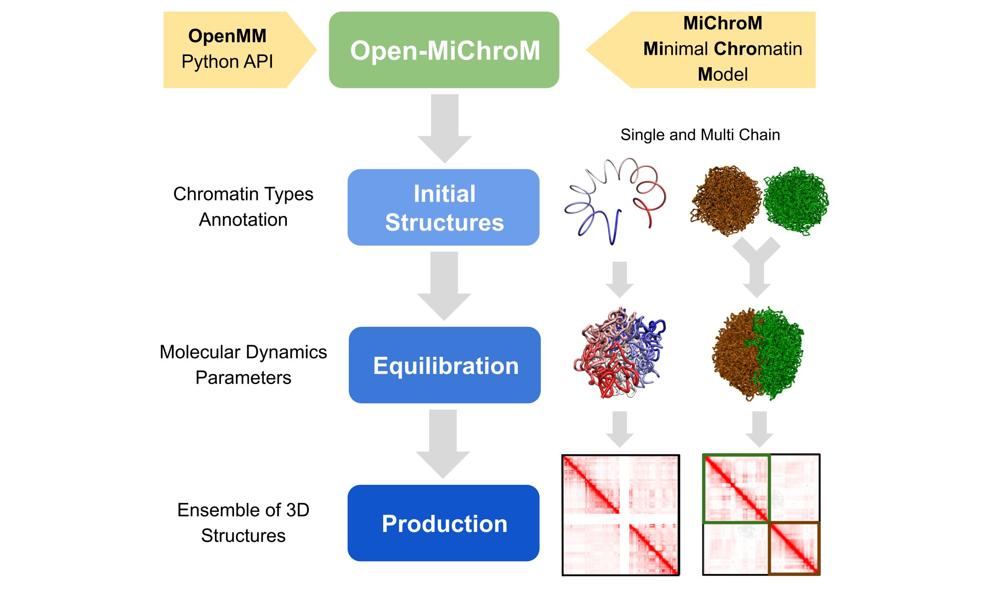
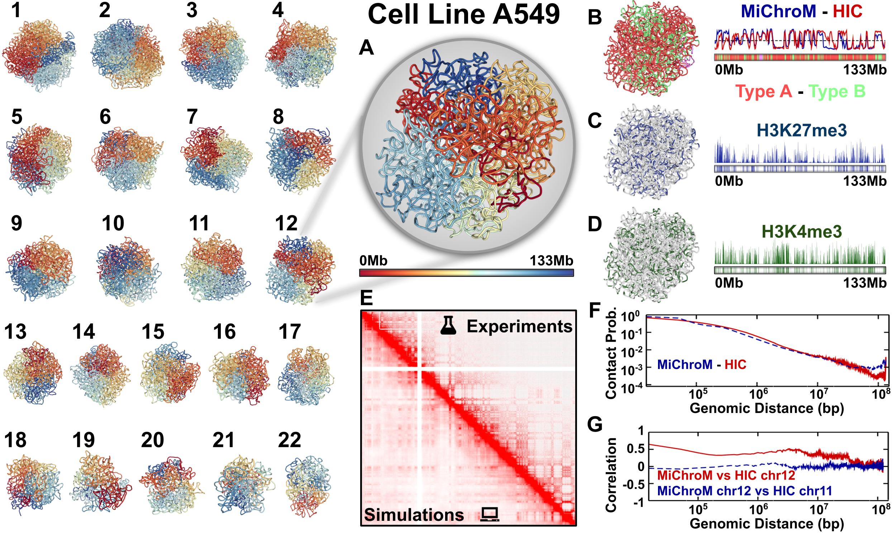

OpenMiChroM
===========

|Citing OpenMiChroM| |PyPI| |conda-forge| |ReadTheDocs| |NDB| |Update| |Downloads| |GitHub-Stars|

.. |Citing OpenMiChroM| image:: https://img.shields.io/badge/cite-OpenMiChroM-informational
   :target: https://open-michrom.readthedocs.io/en/latest/Reference/citing.html
.. |PyPI| image:: https://img.shields.io/pypi/v/OpenMiChroM.svg
   :target: https://pypi.org/project/OpenMiChroM/
.. |conda-forge| image:: https://img.shields.io/conda/vn/conda-forge/OpenMiChroM.svg
   :target: https://anaconda.org/conda-forge/OpenMiChroM
.. |ReadTheDocs| image:: https://readthedocs.org/projects/open-michrom/badge/?version=latest
   :target: https://open-michrom.readthedocs.io/en/latest/
.. |NDB| image:: https://img.shields.io/badge/NDB-Nucleome%20Data%20Bank-informational
   :target: https://ndb.rice.edu/
.. |Update| image:: https://anaconda.org/conda-forge/openmichrom/badges/latest_release_date.svg
   :target: https://anaconda.org/conda-forge/openmichrom
.. |Downloads| image:: https://anaconda.org/conda-forge/openmichrom/badges/downloads.svg
   :target: https://anaconda.org/conda-forge/OpenMiChroM
.. |GitHub-Stars| image:: https://img.shields.io/github/stars/junioreif/OpenMiChroM.svg?style=social
   :target: https://github.com/junioreif/OpenMiChroM

`Documentation <https://open-michrom.readthedocs.io/>`__
| `Install <https://open-michrom.readthedocs.io/en/latest/GettingStarted/install.html>`__
| `Tutorials <https://open-michrom.readthedocs.io/en/latest/Tutorials/Tutorial_Single_Chromosome.html>`__
| `Forum <https://groups.google.com/g/open-michrom>`__

O OpenMiChroM também é mantido por falantes de português.

Overview
========

`OpenMiChroM <https://www.sciencedirect.com/science/article/pii/S0022283620306185>`_ is a Python library for performing chromatin dynamics simulations and analyses. OpenMiChroM uses the `OpenMM <http://openmm.org/>`_ Python API employing the `MiChroM (Minimal Chromatin Model) <https://www.pnas.org/content/113/43/12168>`_ energy function. The chromatin dynamics simulations generate an ensemble of 3D chromosomal structures that are consistent with experimental Hi-C maps. OpenMiChroM also allows simulations of a single or multiple chromosome chains using high-performance computing on different platforms (GPUs and CPUs). It is a highly flexible framework that can be extended for chromatin modeling and simulations across different species and for general biomolecular simulations.

The chromatin dynamics simulations can be performed for different human cell lines, cell phases (interphase to metaphase), and various organisms from `DNAzoo <https://www.dnazoo.org/>`_. Chromatin subcompartment annotations are available at the `NDB (Nucleome Data Bank) <https://ndb.rice.edu/>`_. The OpenMiChroM package accepts the chromatin sequence of compartments and subcompartments as input to create and simulate a chromosome polymer model. Examples of running the simulations and generating *in silico* Hi-C maps can be found `here <https://open-michrom.readthedocs.io/en/latest/Tutorials/Tutorial_Single_Chromosome.html>`_.

Usage
=====

From the repository root, run a short chromosome 10 simulation with the bundled BED file:

::

      from OpenMiChroM.ChromDynamics import MiChroM
      sim = MiChroM(name='chr10', temperature=1.0, timeStep=0.01)
      sim.setup(platform="CPU")
      sim.saveFolder('chr10_simulation')
      sim.buildClassicMichrom(ChromSeq='Tutorials/Chromosome_simulations/inputs/ENCFF963ZUJ.bed', chromosome='chr10')

      sim.createReporters(statistics=True, traj=True, trajFormat="cndb", interval=10)
      sim.run(nsteps=20, interval=10)

Annealing a mitotic chicken chromosome
======================================

The `DT40 annealing tutorial <https://github.com/junioreif/OpenMiChroM/blob/prep-2.0/Tutorials/DT40_Annealing_50kb/Tutorial_DT40_Annealing_50kb.ipynb>`__
models chromosome 7 at 50 kb per bead. Run it offline with the bundled
structures and interaction tables to compare the orientation spectrum of a
new trajectory with an archived 15-minute conformation. The default uses
2,600 CPU steps; set ``RUN = "extended"`` for 130,000 steps per replica.

Structural variants and loop extrusion
======================================

OpenMiChroM can transform symmetric locus matrices and paired directional motif
tracks for deletions, inversions, and tandem duplications. Structural-variant
coordinates are zero-based half-open intervals: ``start`` is included and
``end`` is excluded.

::

      import numpy as np
      from OpenMiChroM import apply_structural_variant, LoopExtrusionManager

      bead = np.arange(8)
      contact_map = 1.0 / (1.0 + np.abs(bead[:, None] - bead[None, :]))
      forward = np.zeros(8)
      reverse = np.zeros(8)
      variant = apply_structural_variant(
          contact_map, "inversion", 2, 5,
          forward_motifs=forward, reverse_motifs=reverse,
      )

      manager = LoopExtrusionManager(
          variant.forward_motifs, variant.reverse_motifs,
          num_steps=4, extruder_count=2, seed=2026,
      )
      loop_trajectory = manager.simulate()

Loop anchor pairs are also zero-based. ``MiChroM.addDynamicLoopPotential``
creates the union of trajectory bonds once; ``updateDynamicLoopPotential`` then
changes which bonds are active in the existing OpenMM Context. The seeded
synthetic tutorials are offline workflow checks, not calibrated biological
predictions. See the
`structural-variants reference <https://open-michrom.readthedocs.io/en/latest/Reference/structural_variants.html>`__,
`matrix tutorial <https://open-michrom.readthedocs.io/en/latest/Tutorials/Tutorial_Apply_Structural_Variants.html>`__,
and `loop-formation tutorial <https://open-michrom.readthedocs.io/en/latest/Tutorials/Tutorial_Loop_Formation.html>`__.

NDB trajectory converters
=========================

OpenMiChroM includes tested library converters for ``NDB <-> CNDB``,
``NDB <-> PDB``, ``NDB <-> SpaceWalk (SPW)``, ``GRO -> NDB``, and the
Bintu et al. ``CSV -> NDB`` layout.  Use an explicit function or let
``convert`` infer the route from the suffixes:

::

      from OpenMiChroM.Converters import convert, ndb_to_cndb

      ndb_to_cndb("ensemble.ndb", "ensemble.cndb")
      convert("ensemble.ndb", "ensemble.pdb")

The converter tutorial runs all eight routes with temporary deterministic
fixtures and semantic checks.  ``.spw`` is the SpaceWalk text format; it is not
the HDF5 ``.swb`` trajectory format produced by the SWB reporter.  See the
`converter reference <https://open-michrom.readthedocs.io/en/latest/Reference/converters.html>`__
and `executable tutorial <https://open-michrom.readthedocs.io/en/latest/Tutorials/Tutorial_NDB_Converters.html>`__.

Streaming remote CNDB files
===========================

Remote CNDB streaming is included in CNDBTools. CNDBTools uses an internal
indexed HDF5 streaming backend to read embedded CNDB indexes and fetch
coordinate byte ranges over HTTP. This extends CNDBTools without changing
existing local ``h5py`` workflows.

After installing this checkout as described below, open an indexed ENCODE file:

::

      from OpenMiChroM.CndbTools import CndbTools

      ENCODE_URL = "https://encode-public.s3.amazonaws.com/2023/02/02/7f75d816-342a-4b49-adbd-aaa499dc5201/ENCFF161DID.cndb"

      tools = CndbTools().load(
          ENCODE_URL,
          trajectory="replica1_chr1",
          index_cache_path="ENCFF161DID.embedded-index.json.gz",
      )

      coords = tools.xyz(
          frames=[1, 10, 100],
          beadSelection=range(0, 100),
      )

      print(coords.shape)
      print(tools.stream_stats())

The full 139 GB CNDB file is not downloaded. The embedded HDF5 index is read
once and can be cached locally. Coordinate reads use HTTP Range requests, and
contiguous bead ranges are read with exact byte ranges. Sparse selections are grouped into byte ranges and returned in the requested
order. If there are too many separate ranges, the reader fetches their
enclosing interval; inspect ``selection_strategy`` in ``stream_stats()``.
When type metadata is present in the index, remote and local workflows both
populate ``ChromSeq`` and ``dictChromSeq``.
The embedded HDF5 metadata reader includes MIT-licensed vendored components from
``hdf5-indexed-reader``/``pyfive`` under ``OpenMiChroM/_cndb_stream/_vendor``.

Classic CNDB files use format version 1; the reporter's version 2 layout
adds a Header and can embed a byte-range index when the writer closes.
Readers also accept unversioned legacy files with a warning. To try the full
write → local read → HTTP read workflow, run the
`indexed CNDB tutorial <https://github.com/junioreif/OpenMiChroM/blob/prep-2.0/Tutorials/write_indexed_cndb.ipynb>`__.

An ``index_cache_path`` is optional. When supplied, the parsed embedded index is
written atomically as a persistent JSON.gz file and is owned by the caller; it is
not deleted automatically. Without that option, metadata caching is in memory
only and is released by ``close()``. Use ``with CndbTools().load(...) as tools``
or call ``tools.close()`` to release local files and remote readers promptly.

Resources
=========

- `Reference Documentation <https://open-michrom.readthedocs.io/>`__: Examples, tutorials, and class details.
- `Installation Guide <https://open-michrom.readthedocs.io/en/latest/GettingStarted/install.html>`__: Instructions for installing **OpenMiChroM**.
- `GitHub repository <https://github.com/junioreif/OpenMiChroM/>`__: Download the **OpenMiChroM** source code.
- `Issue tracker <https://github.com/junioreif/OpenMiChroM/issues>`__: Report issues/bugs or request features.

Tutorial notebook synchronization
=================================

Canonical user-facing tutorial notebooks live under the top-level
``Tutorials/`` folder. Sphinx uses flattened copies under
``docs/source/Tutorials/``. Keep them synchronized with:

::

      python scripts/sync_tutorials.py --clear-outputs

Before committing tutorial changes, check consistency with:

::

      python scripts/sync_tutorials.py --check --clear-outputs

The sync script copies mapped ``.ipynb`` files, skips checkpoint files, preserves
notebook metadata and cell IDs, clears execution output in the docs copies,
and refuses source notebooks with very large
embedded outputs.

Installation and testing
========================

To run the tutorials from this branch, install Git and Conda, then run:

::

    git clone --depth 1 --branch prep-2.0 --single-branch https://github.com/junioreif/OpenMiChroM.git
    cd OpenMiChroM
    conda env create --solver classic -f environment.yml
    conda activate openmichrom-tutorials

The shallow clone includes the tutorials and test inputs without downloading
historical trajectories. Conda installs OpenMM and Jupyter separately.
OpenMiChroM itself is installed in editable mode.
In VS Code, open the repository folder, choose a notebook under ``Tutorials/``,
select the ``openmichrom-tutorials`` kernel, and use **Run All**. For a short
CPU run of every tutorial and the package tests:

::

    python scripts/validate.py fast

Use ``complete`` to also build the documentation and test the installed wheel.
Add ``--network`` to test a live ENCODE trajectory. Production-length
simulations are not part of the default test. For details see the
`validation guide <https://github.com/junioreif/OpenMiChroM/blob/prep-2.0/docs/source/GettingStarted/validation.rst>`__.
For the published package rather than this branch, use
``python -m pip install OpenMiChroM`` or
``conda install -c conda-forge openmichrom``.

How to cite
===========

For the software, cite Oliveira Junior et al., *A scalable computational
approach for simulating complexes of multiple chromosomes*, Journal of Molecular
Biology **433**, 166700 (2021), `doi:10.1016/j.jmb.2020.10.034 <https://doi.org/10.1016/j.jmb.2020.10.034>`__.
See the `citation guide <https://github.com/junioreif/OpenMiChroM/blob/prep-2.0/docs/source/Reference/citing.rst>`__ and
`BibTeX file <https://github.com/junioreif/OpenMiChroM/blob/prep-2.0/docs/source/Reference/OpenMiChroM.bib>`__ for optimization,
NDB/CNDB, and the chicken DT40 mitosis and pulling studies.
