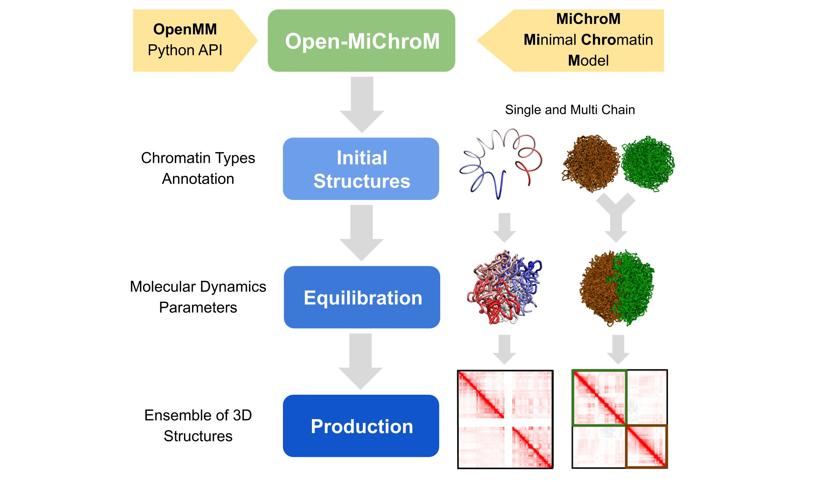
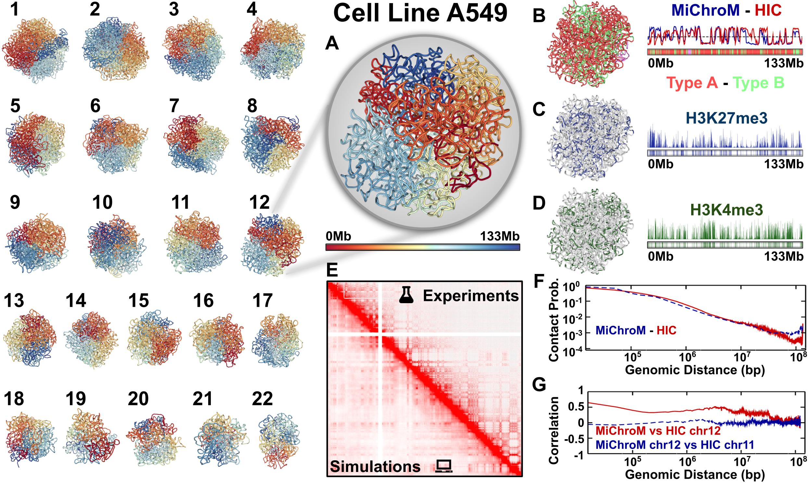

.. _introduction:

============
Introduction
============

OpenMiChroM is a Python library for simulating and analyzing chromosome
dynamics :cite:p:`oliveira_junior_scalable_2021`. It uses OpenMM to simulate
one or more chromosome chains on a CPU or GPU. The MiChroM energy function
relates chromatin type and genomic separation to the ensemble of folded
chromosome structures :cite:p:`di_pierro_transferable_2016`.

The :doc:`single-chromosome tutorial </Tutorials/Tutorial_Single_Chromosome>`
starts from chromatin type annotations and generates an *in silico* contact
map from simulated structures. The Nucleome Data Bank provides annotations
and trajectories for multiple cell lines :cite:p:`contessoto_nucleome_2021`.
The :doc:`DT40 annealing tutorial </Tutorials/Tutorial_DT40_Annealing_50kb>`
uses chicken chromosome 7 at 50 kb resolution to measure helical periods
from correlations along the chain :cite:p:`contessoto_cell_cycle_2025`.
The separate :doc:`pulling tutorial </Tutorials/Tutorial_Pulling>` uses a
mitotic chicken DT40 chromosome to study the response to axial force
:cite:p:`ruben_pulling_2023`.

